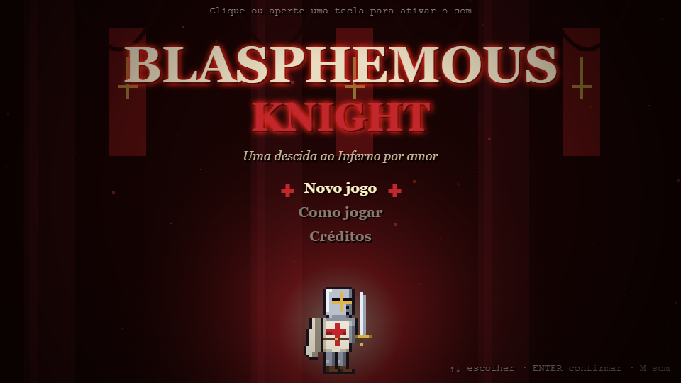
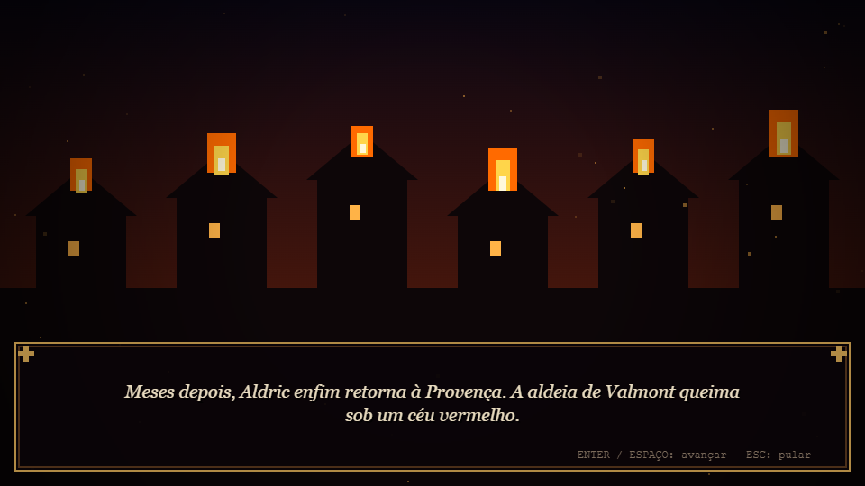
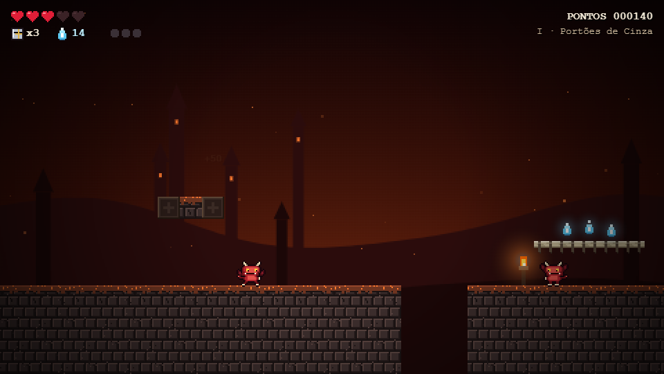
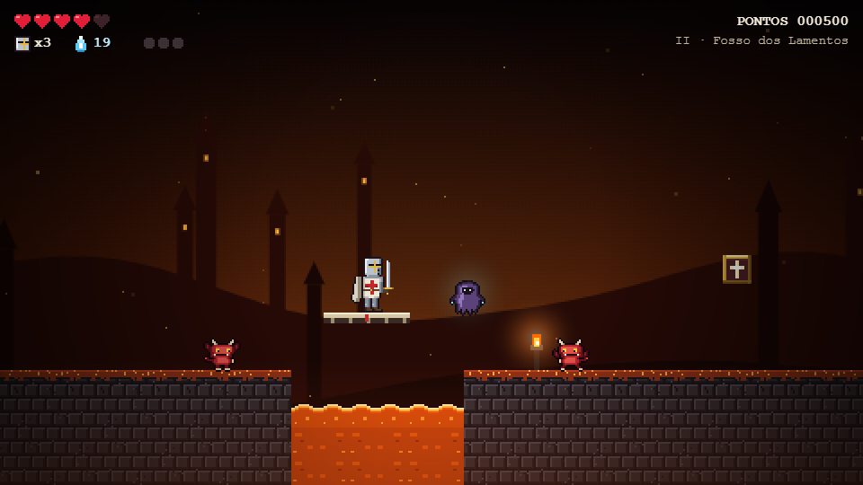
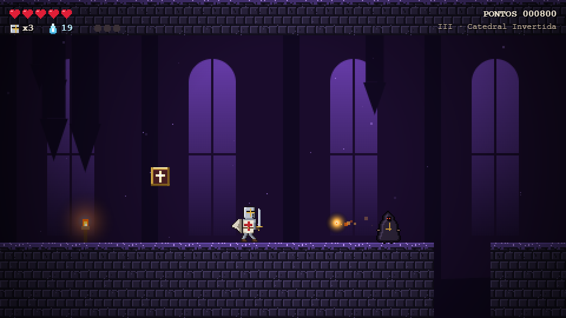
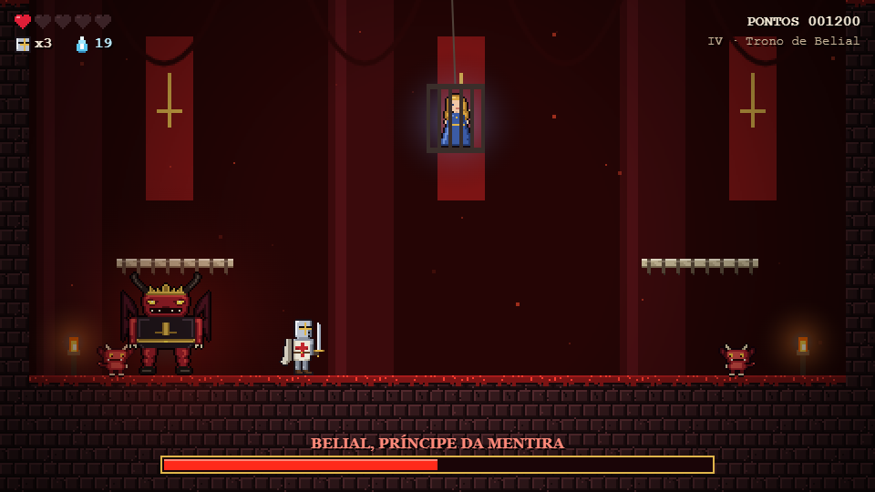

# Blasphemous Knight



## 1. Identificação

| | |
|---|---|
| **Jogo** | Blasphemous Knight |
| **Grupo** | Sem nome (identificado pelos integrantes abaixo) |
| **Disciplina** | Usabilidade, desenvolvimento web, mobile e jogos |
| **Professor** | Elzo Brito dos Santos Filho |
| **Atividade** | A3 – Desenvolvimento de um Jogo |

| Integrante | RA |
|---|---|
| Pedro Henrique Espinosa Mantana | 825133461 |
| Kaique Gonçalves da Silva | 825152843 |
| Gustavo Trajano Dos Reis Padilha | 825157289 |
| João Paulo de Mattos Queiroz | 825148044 |
| Hyohan Mertz Santamaria | 825151448 |

## 2. Descrição

Plataforma 2D de ação com rolagem lateral, no estilo dos clássicos do Super
Mario, ambientado no Inferno medieval. O jogador controla Sir Aldric, um
cavaleiro templário que luta com a espada Misericórdia através de três
círculos do Inferno até o trono do demônio Belial. Pelo caminho ele quebra
pedras, golpeia altares profanados, quica sobre demônios com a espada e recolhe
as contas do rosário da esposa, que decidem qual dos dois finais o jogador vê.

**Premissa:** em 1291, durante a queda de Acre, Aldric sobreviveu fazendo um
pacto com um estranho de olhos rubros, sem saber que era Belial, Príncipe da
Mentira. Ao voltar para casa, o demônio cobra a dívida e arrasta sua esposa,
Isolde, para o Inferno. Declarado blasfemo pela própria Ordem, Aldric desce
pela Fenda de Cinzas para resgatá-la. A história completa e todas as falas
estão em [ROTEIRO.md](ROTEIRO.md).

## 3. Como rodar

**Pré-requisito:** um navegador atualizado (Chrome, Edge ou Firefox). Não há
nada para instalar.

1. Baixe ou clone esta pasta.
2. Dê dois cliques em `index.html`.
3. Clique na tela ou aperte uma tecla para ativar o som.

Opcional, com servidor local (útil para abrir em outro aparelho da rede):

```powershell
python -m http.server 8000
```

e acesse <http://localhost:8000>.

> Não existe `requirements.txt` porque o jogo não tem dependências: é HTML,
> CSS e JavaScript puro, sem bibliotecas nem etapa de build.

## 4. Controles

| Tecla | Ação |
|---|---|
| `←` `→` ou `A` `D` | Mover |
| `Espaço`, `K` ou `Z` | Pular (segurar = pulo mais alto) |
| `Espaço` de novo no ar | Pulo duplo (volta a valer ao tocar o chão ou ao quicar com o golpe para baixo) |
| `J`, `X` ou clique | Golpe de espada |
| `↑` + golpe | Golpe para cima |
| `↓` + golpe (no ar) | Golpe para baixo: quica em inimigos e bolas de fogo |
| `↓` + pulo | Descer de uma plataforma |
| `P` ou `Esc` | Pausar / continuar |
| `M` | Ligar ou desligar o som |
| `Enter` / `Espaço` | Avançar diálogos e confirmar nos menus |
| `Esc` (em diálogo) | Pular a conversa |
| `1` `2` `3` `4` (no menu) | Começar direto numa fase (atalho para a apresentação) |

Os controles também aparecem dentro do jogo, no menu **Como jogar** e nas
falas de Frei Anselmo na primeira fase.

## 5. Regras

- **Objetivo:** atravessar os três círculos (Portões de Cinza, Fosso dos
  Lamentos e Catedral Invertida), chegando ao portal no fim de cada um, e
  derrotar Belial no quarto círculo.
- **Vida:** 5 corações e 3 vidas. Inimigos, bolas de fogo e espinhos tiram 1
  coração. Cair na lava ou no abismo também tira 1 coração e devolve o
  cavaleiro à última cruz de pedra.
- **Derrota:** perder todas as vidas leva à tela **Você caiu**, com as opções
  *Tentar de novo* (recomeça a fase) e *Menu principal*.
- **Cruzes de pedra (checkpoints):** ao tocar, o caminho é consagrado: você
  volta ali ao morrer e recupera todos os corações.
- **Pontuação:** alma 10 · diabrete 50 · alma penada 80 · templário caído 120 ·
  bola de fogo rebatida 10 · conta do rosário 500 · portal 300 · golpe em
  Belial 20 · vitória sobre Belial 5000. O recorde fica salvo no navegador.
- **Almas:** a cada 50 almas recolhidas o cavaleiro ganha uma vida extra.
- **Altares profanados:** acerte por baixo (com a cabeça) ou com a espada para
  libertar almas ou um coração.
- **Contas do rosário:** há 3 em cada fase, algumas escondidas atrás de pedras
  rachadas. Com **7 ou mais das 9** o jogador vê o final **Redenção**; com
  menos, o final **Sacrifício**.
- **Saves:** há 3 espaços de save (Save 01, 02 e 03). Em **Novo jogo** você
  escolhe onde guardar a jornada; para usar um espaço ocupado, o jogo pede
  confirmação antes de apagar o save antigo. O jogo salva sozinho no
  começo de cada fase e em cada cruz de pedra, e também quando você escolhe
  **Salvar jogo** no menu de pausa. Em **Continuar**, a jornada volta na fase e
  na última cruz de pedra salvas, com pontos, vidas, almas e contas do
  rosário. Os saves ficam no navegador (`localStorage`): se trocar de
  navegador ou limpar os dados do site, eles se perdem.
- **Dificuldade crescente:** cada círculo tem inimigos mais rápidos e
  agressivos, mais armadilhas e plataformas móveis. Belial tem duas fases: na
  segunda fica mais rápido, invoca diabretes e lança mais fogo.

## 6. Divisão de tarefas

| Integrante | O que fez |
|---|---|
| Pedro Henrique Espinosa Mantana | [preencher] |
| Kaique Gonçalves da Silva | [preencher] |
| Gustavo Trajano Dos Reis Padilha | [preencher] |
| João Paulo de Mattos Queiroz | [preencher] |
| Hyohan Mertz Santamaria | [preencher] |

## 7. Créditos

Todo o conteúdo do jogo foi criado para este projeto. **Nenhum arquivo de
terceiros** (imagem, fonte ou som) é usado:

| Conteúdo | Onde está | Autoria |
|---|---|---|
| Pixel art (personagens, inimigos, blocos, itens) | `src/sprites.js`, desenhada em código | Criada para o projeto |
| Cenários e efeitos (paralaxe, brasas, chamas, golpe da espada) | `src/render.js` | Criados para o projeto |
| Músicas (menu, fases, chefe, final) | `src/audio.js`, sintetizadas com Web Audio | Compostas para o projeto |
| Efeitos sonoros | `src/audio.js`, sintetizados com Web Audio | Criados para o projeto |
| História, personagens e falas | `src/story.js` e `ROTEIRO.md` | Criados para o projeto |
| Fontes | Georgia e Courier New, fontes do sistema | Não são distribuídas com o jogo |

**Inspirações (referência, sem uso de material):** *Dante's Inferno* (Visceral
Games, 2010), pela premissa do cruzado que desce ao Inferno atrás da esposa, e
*Super Mario Bros.* (Nintendo, 1985), pela estrutura de plataforma com blocos
para acertar por baixo. Personagens, nomes, círculos e roteiro são próprios.

## 8. Tecnologia

- **Linguagem:** JavaScript (ES2020), HTML5 e CSS.
- **Bibliotecas:** nenhuma. Usamos só APIs nativas do navegador: Canvas 2D para
  o desenho, Web Audio para som e música e `localStorage` para o recorde.
- **Por que não pygame:** queríamos que o jogo rodasse **no navegador**, sem
  instalar Python nem bibliotecas. Assim qualquer pessoa joga com dois cliques
  no `index.html`, inclusive o professor na correção, e o jogo pode ser
  publicado em um site. A estrutura é a mesma vista em aula com pygame: laço
  principal (entrada → atualização → desenho), estados e passo de física fixo
  a 60 atualizações por segundo.
- Os scripts são carregados como scripts comuns, e não como módulos ES, porque
  o navegador bloqueia módulos abertos direto do disco (`file://`).

### Estrutura do projeto

```
blasphemous-knight/
├── index.html          página e canvas; carrega os scripts em ordem
├── README.md
├── ROTEIRO.md          lore completa e roteiro com todas as falas
├── docs/screenshots/   capturas de tela
└── src/
    ├── core.js         configurações, paletas e utilitários
    ├── input.js        teclado e mouse
    ├── audio.js        efeitos sonoros e músicas sintetizadas
    ├── sprites.js      pixel art (assets gerados em código)
    ├── story.js        personagens, cutscenes e falas
    ├── levels.js       mapas das fases (texto editável)
    ├── world.js        mapa de blocos e colisões
    ├── entities.js     cavaleiro, inimigos, Belial, projéteis e itens
    ├── render.js       cenários, HUD, diálogos e telas
    └── game.js         estados do jogo e laço principal
```

Como arte e som são gerados por código, a pasta de assets equivale a
`src/sprites.js` (imagens) e `src/audio.js` (sons).

### Como editar as fases

Cada fase em `src/levels.js` é uma lista de linhas de texto, e cada caractere
é um bloco de 16×16 pixels (`#` pedra, `?` altar, `i` diabrete, `R` conta do
rosário...). A legenda completa está no topo do arquivo.

## 9. Uso de IA

> **Declaração obrigatória (seção 6 do enunciado). Revisem e completem este
> texto antes de entregar: ele precisa refletir exatamente o que o grupo fez.**

- **Ferramenta:** Claude (Anthropic), pelo Claude Code.
- **Para quê:** gerar a primeira versão do código do jogo, da pixel art em
  código, das músicas e efeitos sintetizados, do desenho das fases, da lore e
  das falas, e o rascunho deste README.
- **Em quais arquivos:** `index.html`, todos os arquivos de `src/`,
  `ROTEIRO.md` e `README.md`.
- **O que o grupo fez:** [descrevam aqui o que revisaram, mudaram, testaram e
  criaram por conta própria].

O grupo revisou o código e sabe explicar cada parte dele, como pede o
enunciado.

## 10. Capturas de tela

| | |
|---|---|
|  |  |
| Introdução: Belial leva Isolde | Círculo I: Portões de Cinza |
|  |  |
| Círculo II: Fosso dos Lamentos | Círculo III: Catedral Invertida |
|  | |
| Belial, na segunda fase da luta | |
